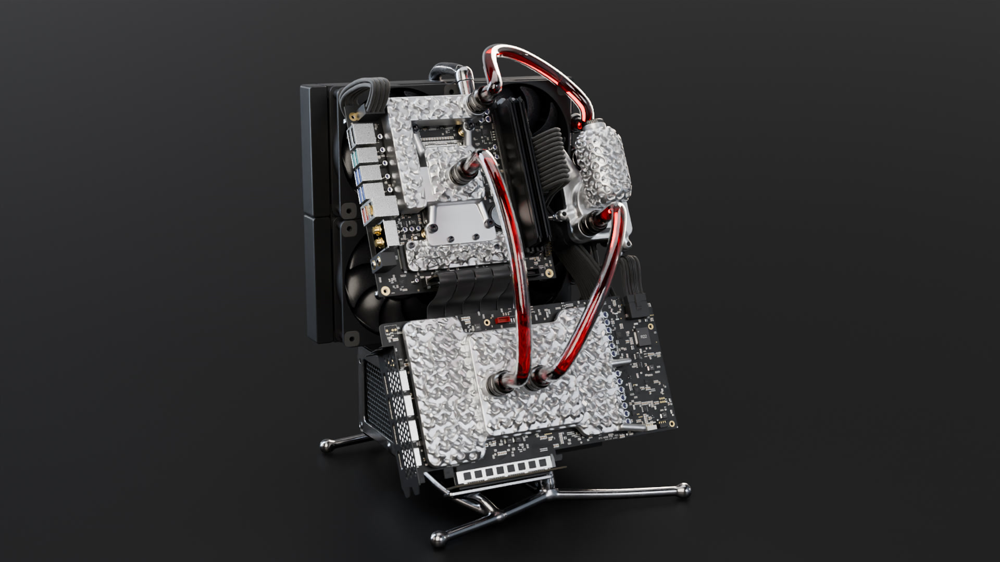

# MARROW

**Printed bone. Liquid marrow.** An open small-form-factor chassis for a mini-ITX AM5 board and a liquid-cooled
RTX 4090: five 316L steel "bones", four AlSi10Mg "organs", one coolant loop. Every printed part fits a 300 mm
metal printer at JLC3DP or PCBWay.

> **Status: design study.** Nothing in this repository has been printed, assembled or tested. Every temperature,
> pressure and stress quoted here comes from the simulations in `sim/`. Read "Before you order" first.

- **Site (source):** `site/index.html` - serve the `site/` folder, or open the published link from the pull request.
- **Film:** `site/media/film.mp4` (80 s, original synthesised score).
- **Print files:** `exports/print/*.3mf` (nine parts).

## The build this was designed around

| Item | What was assumed |
|---|---|
| Graphics card | MSI GeForce RTX 4090 SUPRIM LIQUID 24G (PCB MS-V510), stock AIO removed |
| Motherboard | mini-ITX, AM5 (exact model not known - a representative layout is modelled) |
| CPU | Ryzen 7 X3D class, 120 W design load |
| Power supply | EVGA SuperNOVA NEX650G, ATX, bay sized 150 x 86 x 180 mm |
| Radiators | 2 x 240 mm slim (27 mm) **aluminium**, four 120 mm fans |
| Pump | DDC-class, on the printed top |

Envelope 300 x 305 x 376 mm (W x D x H). The board and the card share one show
plane leaning back 25 degrees; all external cables (board I/O, display outputs, mains) leave on the left.

## Printed parts

Prices are automated, pre-review quotes scaled by volume (JLC3DP / PCBWay, November 2026).

| File | Part | Metal | Mass | Bounding box (mm) | Fits 300 x 300 x 290 | Watertight | JLC3DP | PCBWay |
|---|---|---|---|---|---|---|---|---|
| `gpu_block.3mf` | Organ I - RTX 4090 full-cover block | AlSi10Mg | 491 g | 209 x 124 x 27 | yes | yes | $195 | $276 |
| `monoblock.3mf` | Organ II - CPU + VRM monoblock (AM5) | AlSi10Mg | 212 g | 93 x 131 x 28 | yes | yes | $84 | $119 |
| `heart.3mf` | Organ III - pump top + 41 mL reservoir | AlSi10Mg | 156 g | 74 x 113 x 51 | yes | yes | $62 | $88 |
| `m2_sink.3mf` | Organ IV - M.2 / chipset sink (clamped to the monoblock tail) | AlSi10Mg | 33 g | 107 x 27 x 17 | yes | yes | $13 | $18 |
| `frame_pelvis.3mf` | Pelvis - keel, feet, PSU cradle, riser shelf | 316L | 839 g | 254 x 282 x 111 | yes | yes | $185 | $282 |
| `frame_lumbar.3mf` | Lumbar - lower front spine, GPU ribs | 316L | 317 g | 239 x 93 x 203 | yes | yes | $70 | $107 |
| `frame_thoracic.3mf` | Thoracic - upper front spine, board ribs | 316L | 363 g | 200 x 111 x 214 | yes | yes | $80 | $122 |
| `frame_dorsal.3mf` | Dorsal - lower rear spine, radiator ribs | 316L | 523 g | 234 x 23 x 268 | yes | yes | $115 | $176 |
| `frame_cervical.3mf` | Cervical - upper rear spine, crown | 316L | 272 g | 234 x 92 x 122 | yes | yes | $60 | $92 |
| | **All nine** | | **3.21 kg** | | | | **$865** | **$1,278** |

Why two metals: neither service prints copper, and steel cold plates do not work on a 4090 (see below). So the
structure is 316L and everything that carries heat is aluminium.

## What the simulations say

**Cold plates** (two-scale conjugate model, `sim/cell` + `sim/macro`; temperatures are rises over the coolant
entering the block):

| Case | Flow | Pressure drop | Pad temperatures | Energy balance error |
|---|---|---|---|---|
| 4090 block, AlSi10Mg | 3 L/min | 5.1 kPa | die +24.4 K (peak +29.8), memory +3.7 K, VRM +11.9 K | 0.00 % |
| 4090 block, 316L (for comparison) | 3 L/min | 5.1 kPa | die +122.2 K, memory +10.6 K, VRM +76.9 K | 0.00 % |
| CPU + VRM monoblock, AlSi10Mg | 3 L/min | 5.1 kPa | CPU pad +8.5 K, VRM +4.1 K | 0.00 % |

**Whole loop** at 1500 rpm fans in a 25 C room (`sim/loop`; band = +-20 % radiator performance):

| Cold-plate metal | Load | Heat | Flow | Coolant | 4090 hot spot | CPU junction |
|---|---|---|---|---|---|---|
| AlSi10Mg | 4K gaming | 487 W | 5.6 L/min | 40 C | 65 C (62-68) | 68 C |
| AlSi10Mg | Synthetic full load | 619 W | 5.6 L/min | 44 C | 73 C (70-77) | 89 C |
| 316L | 4K gaming | 487 W | 5.6 L/min | 40 C | 136 C (134-140) | 86 C |
| 316L | Synthetic full load | 619 W | 5.6 L/min | 44 C | 157 C (154-162) | 118 C |

Headline: **73 C simulated 4090 hot spot at full load** with aluminium blocks.

**CPU margin.** At the synthetic full load (120 W into an X3D part, which no game does) the model puts the junction at 89.4 C with the fans at 1500 rpm. The limit of the Ryzen 7 X3D parts is 89 C, so the chip would hold temperature by throttling until the fans reach 1800 rpm (87.2 C). Most of that rise is the chip's own junction-to-lid resistance (0.30 K/W assumed), not the block. At a 75 W gaming load the junction is 68 C.

**M.2 / chipset sink.** The first version of this part was passive, and the model failed it: with 13 W on it in still air the SSD pad ran +152 to +305 K over the room (film coefficient 10 to 5 W/m2K), so the lattice alone is good for about 3 W. The monoblock therefore has a solid conduction tail that clamps onto the sink through a 0.5 mm gap pad. With that, at full load the model puts the SSD controller at 67 C and the chipset at 72 C (7 W and 6 W continuous, coolant 44 C), and 83 % of the heat leaves through the loop.

**Frame** (`sim/fea`, 86,648 hex elements, 6.2 kg of hardware on a 2.33 kg frame):

| Load case | Peak deflection | Peak stress | Margin on 400 MPa yield |
|---|---|---|---|
| Standing, 1 g | 0.16 mm | 11 MPa | 37x |
| Standing, 1 g down + 1 g sideways | 1.37 mm | 27 MPa | 15x |
| Lifted by the crown, 1 g | 0.50 mm | 18 MPa | 22x |

**Checks**

- Flow kernel vs analytic Poiseuille flow at the lattice's channel resolution (13 cells): +0.33 %.
- Heat kernel vs plate Nusselt number (7.54 developed, Hausen-type while developing): -4.9 to -14.3 % (under-predicts, the safe direction).
- Block models conserve energy to within 0.00 %.
- Frame FEA reactions equal the applied weight (83.9 N).

How it works: a patch of each lattice (with its real floor and ceiling) is resolved with a D3Q19 TRT lattice-Boltzmann
solver and a TVD finite-volume heat solver. That gives each lattice a Darcy-Forchheimer resistance, a volumetric
heat-transfer law and an effective metal conductivity. A 0.5 mm block-level model built from the same CAD fields as
the print files then solves porous flow plus a two-temperature energy equation with those laws. Expect about +-25 %
on the cold-plate temperature rises.

## Before you order

1. **Set the board dimensions.** The VRM layout under the monoblock is representative, not yours. Measure your board
   and edit `BOARD['vrm_left']`, `BOARD['vrm_top']`, `BOARD['socket']` and `MONOBLOCK['arm_*']` in `design/params.py`,
   then rerun the generators. The AM5 hole pattern (54 x 90 mm, UNC 6-32) and the mini-ITX holes are standard.
2. **Measure the 4090's component heights.** Hole positions, memory, VRM rows and outline were measured from PCB
   photographs (about +-0.3 mm) - `design/data/gpu_pcb_layout.json`. Heights of the die, inductors and capacitors are
   not published; the `z_*` values in `params.GPU` are assumptions. Also confirm your card says "MS-V510" on the PCB.
3. **Power supply.** MSI lists 850 W as the minimum for this card and recommends 1000 W. A 650 W unit is below that,
   and the NEX650G predates the 16-pin connector, so the card would run from the adapter. Treat the PSU as the first
   thing to upgrade.
4. **Keep the loop all-aluminium.** Aluminium blocks with copper or brass radiators corrode. Use aluminium radiators
   (the SUPRIM's own 240 mm radiator is aluminium), stainless or anodised fittings, and coolant with aluminium inhibitors.
5. **Post-process the prints.** Tap the G1/4 ports (11.8 mm pilots) and spot-face their seats, tap the M3/M4 pilots,
   lap the die / IHS / memory lands flat, then leak-test at 1 bar before filling. Thin printed aluminium often needs sealing.
6. **Tail joint.** The monoblock's tail lands on the M.2 sink with a 0.5 mm gap pad (6 W/mK assumed) and two M3 x 6
   screws into blind holes. Fit the sink first, then the monoblock; check the gap on your board before choosing the pad.
7. **Check the riser.** The card sits below the board on a 200 mm PCIe 4.0 riser that runs behind the PCB.

## Repository map

| Path | What it is |
|---|---|
| `design/params.py` | Single source of truth for every dimension; writes `design/layout.json` |
| `design/sdf.py`, `part.py`, `meshfix.py` | Implicit-modelling toolkit (gyroid, Voronoi, bones), meshing, watertight export |
| `design/gpu_block.py`, `monoblock.py`, `heart.py`, `m2_sink.py`, `frame.py` | Generators for the nine printed parts |
| `sim/cell/` | Resolved lattice flow and heat transfer (LBM + finite volume) |
| `sim/macro/` | Block-level conjugate model, M.2 sink model |
| `sim/loop/`, `sim/fea/` | Loop operating point and temperatures; frame FEA |
| `sim/validation/`, `sim/post/` | Kernel validation; figures and site data |
| `render/` | Procedural PC hardware, scene assembly, shots (Blender 4.5, Cycles) |
| `media/score/`, `media/film/` | Score synthesiser and its QA; film editor and simulation plates |
| `site/` | The website (static) |
| `exports/print/` | 3MF print files; `exports/meta/` per-part mass, size, cost, checks |

Rebuild everything: `tools/build_all.sh` (CAD, simulations, site data), then the render and film steps listed in it.

## Credits

Studio lighting: "Studio Small 09" from Poly Haven (CC0). Typefaces in the film and site: Bodoni Moda and IBM Plex
(SIL Open Font License). The score is original and synthesised by `media/score/score.py`. Product and company names
are used only to say what the parts fit.
