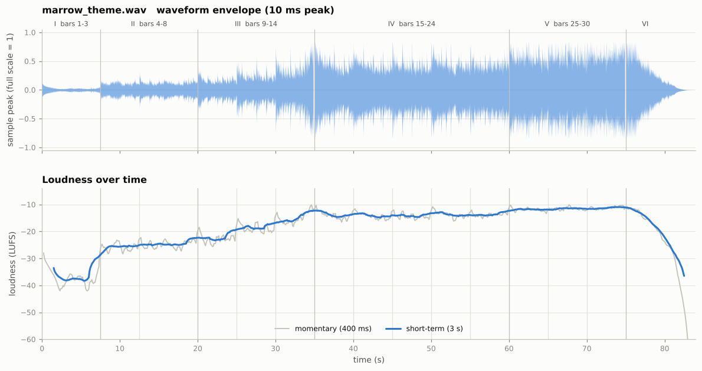
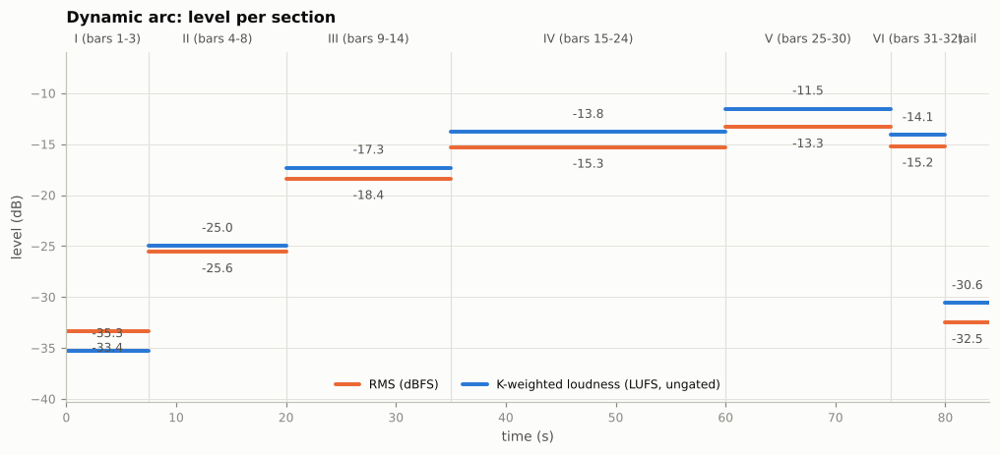
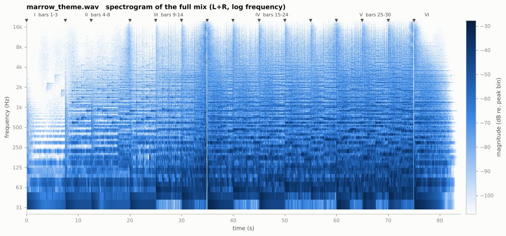
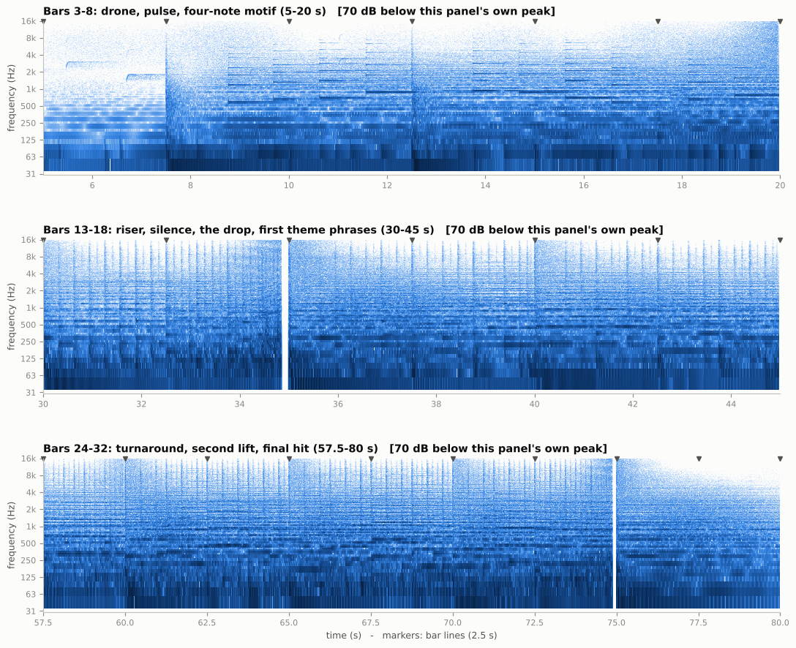
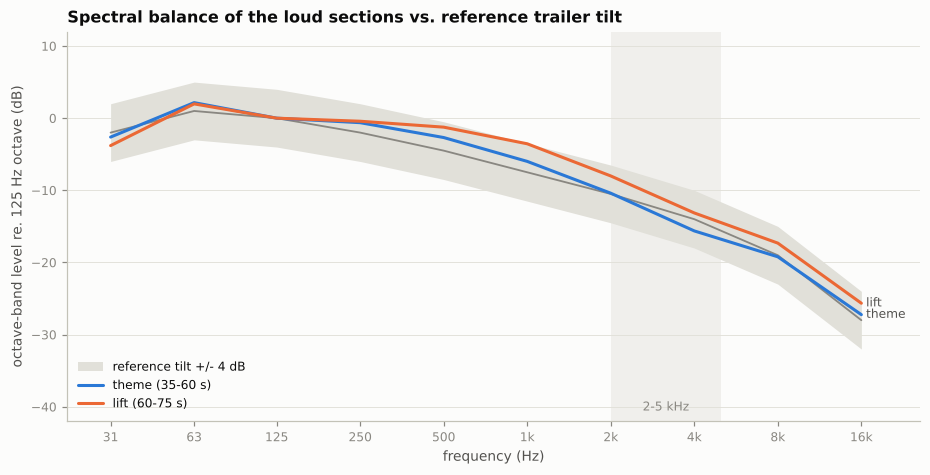
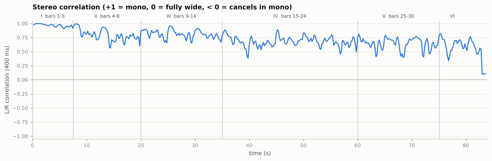
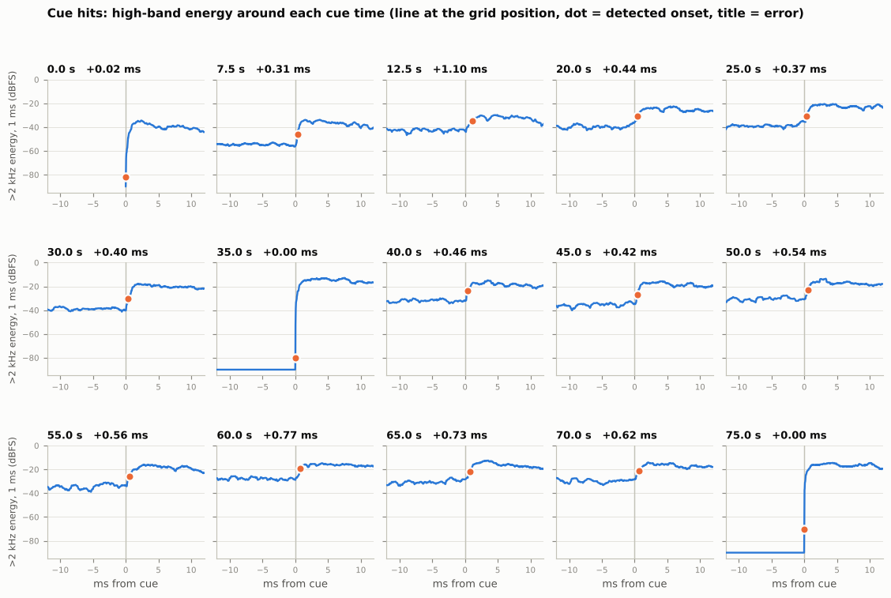
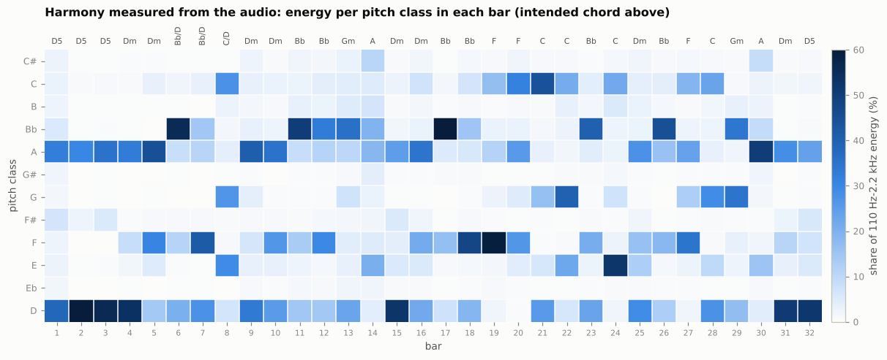
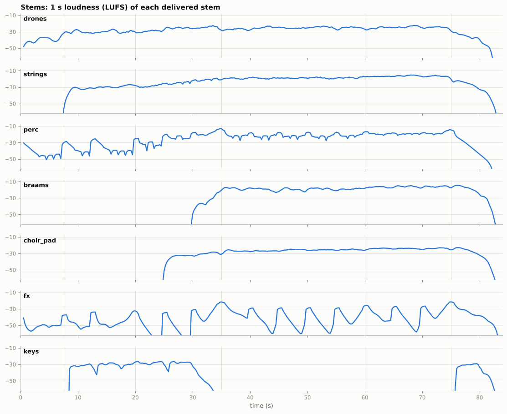
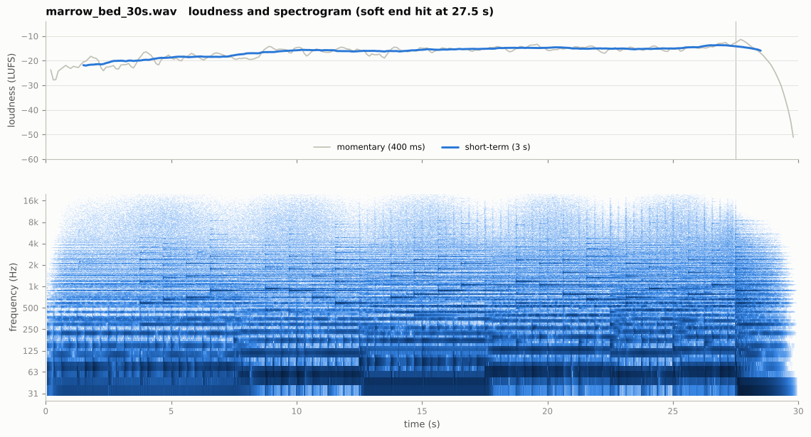

# MARROW score - QA by measurement

Nobody listened to this render: the machine that built it has no ears. Everything below is measured from the delivered files by `qa.py` (which reads the audio, not the synthesis code) and regenerated on every run of `score.py`.

**23 of 24 checks pass.**

| Check | Target | Measured | Result |
|---|---|---|---|
| Theme format | 48 kHz / 24-bit / stereo / 84.000 s | 48000 Hz / PCM_24 / 2 ch / 84.000 s (4032000 samples) | pass |
| Integrated loudness | -14 LUFS +/- 0.5 | -14.00 (own BS.1770-4) / -14.04 (pyloudnorm) / -14.0 (ffmpeg ebur128) | pass |
| True peak | <= -1.0 dBTP | -1.60 dBTP (8x oversampled) / -1.6 (ffmpeg) | pass |
| Clipping | 0 full-scale samples | 0 full-scale samples, sample peak -1.63 dBFS | pass |
| DC offset | < -60 dBFS | L -3.1e-05, R -3.3e-05 (-90 dBFS); worst 1 s window -56 dBFS | pass |
| Dynamic arc (RMS per section) | I < II < III < IV < V, VI and tail fall away | -33.4 / -25.6 / -18.4 / -15.3 / -13.3 / -15.2 / -32.5 dBFS | pass |
| Tail ends in silence | last 0.5 s < -60 dBFS RMS | -90.6 dBFS RMS, final sample 1.2e-07 | pass |
| Silence before the drop | ~150 ms gap ending at 35.000 s | 150 ms at -141.4 dBFS RMS (peak -138.5) | pass |
| Spectral balance, 35-75 s | every octave within +/- 4 dB of the reference tilt | worst deviation +2.7 dB at 1000 Hz; tilt 250 Hz-8 kHz -3.8 dB/oct | pass |
| No 2-5 kHz build-up | third-octaves 2-5 kHz <= +2 dB over the fitted tilt | max +1.5 dB | pass |
| Sub at the hits (30-80 Hz, first 1 s) | within 6 dB of the full-band RMS at every hit from the drop on | sub minus full-band: -4.4 ... -2.8 dB | pass |
| The drop is the biggest hit before the finale | 35.0 s momentary loudness >= every other hit before 75 s | -10.2 LUFS at 35.0 s vs. max -10.2 elsewhere (final hit -10.8) | pass |
| Stereo correlation | mostly positive (>= 95 % of 400 ms windows > 0) | mean +0.73, 5th percentile +0.47, min +0.10 at 83.4 s, 100.0 % > 0 | pass |
| Mono fold-down | loses < 3 LU; side below 100 Hz < -15 dB re. mid | 1.01 LU lost; low side -19.3 dB | pass |
| Cue hits on the grid (detector A, leading edge) | all 15 within +/- 5 ms | worst |error| 1.10 ms, mean 0.45 ms | pass |
| Cue hits on the grid (detector B, spectral flux) | all 15 within +/- 5 ms | worst |error| 1.17 ms, mean 0.67 ms | pass |
| Key (Krumhansl-Kessler on the audio) | D minor | D minor (r = 0.87); next: F major (r = 0.74) | pass |
| Chords follow the score | chord tones carry >= 50 % of the pitched energy in >= 28 of 32 bars | 32 of 32 bars; median 81 %, minimum 54 % (bar 14) | pass |
| Rhythmic pulse in the texture | 8th- or 16th-note modulation >= 10 dB over the floor in build, theme and lift | build 23 / 20 dB; theme 24 / 19 dB; lift 13 / 17 dB | pass |
| Stems | 7 stems, 84.000 s each, sum nulls against the master | residual peak -118.5 dBFS | pass |
| Lossy encodes | same loudness (+/- 0.3 LU), sample-aligned, true peak <= -1.0 dBTP | mp3 -14.00 LUFS, +0 samples, -1.42 dBTP; m4a -14.04 LUFS, +0 samples, 0.53 dBTP | **FAIL** |
| Bed format | 48 kHz / 24-bit / stereo / exactly 30.000 s | 48000 Hz / PCM_24 / 30.000 s | pass |
| Bed loudness / peak | -16 LUFS +/- 0.5, <= -1.0 dBTP | -16.00 LUFS (ffmpeg -16.0), -1.62 dBTP, LRA 5.3 LU | pass |
| Bed end hit | onset at 27.500 s +/- 5 ms | +1.23 ms (strength 13 dB) | pass |

## 1. Files

| File | Format | Duration | Size | SHA-256 (first 12) |
|---|---|---|---|---|
| `marrow_theme.wav` | WAV 48000 Hz 24-bit 2 ch | 84.000 s | 24.2 MB | `ed99f9a5ccaa` |
| `marrow_theme.mp3` | MP3 320 kb/s 48000 Hz | 84.000 s decoded | 3.4 MB | `c202e09a668e` |
| `marrow_theme.m4a` | AAC 261 kb/s 48000 Hz | 84.011 s decoded | 2.7 MB | `c33fdb63ac61` |
| `marrow_bed_30s.wav` | WAV 48000 Hz 24-bit 2 ch | 30.000 s | 8.6 MB | `d70c969bce78` |
| `marrow_bed_30s.m4a` | AAC 258 kb/s 48000 Hz | 30.016 s decoded | 968 kB | `3189a694da02` |
| `stems/drones.wav` | WAV 48000 Hz 24-bit 2 ch | 84.000 s | 24.2 MB | `2dd55cba9c55` |
| `stems/strings.wav` | WAV 48000 Hz 24-bit 2 ch | 84.000 s | 24.2 MB | `53bb680e2ce6` |
| `stems/perc.wav` | WAV 48000 Hz 24-bit 2 ch | 84.000 s | 24.2 MB | `1c4e4524cfb9` |
| `stems/braams.wav` | WAV 48000 Hz 24-bit 2 ch | 84.000 s | 24.2 MB | `cc1ece806094` |
| `stems/choir_pad.wav` | WAV 48000 Hz 24-bit 2 ch | 84.000 s | 24.2 MB | `9d72abb82bf2` |
| `stems/fx.wav` | WAV 48000 Hz 24-bit 2 ch | 84.000 s | 24.2 MB | `dfba524daf39` |
| `stems/keys.wav` | WAV 48000 Hz 24-bit 2 ch | 84.000 s | 24.2 MB | `75edb0a16643` |

Also: `score.py` (source), `qa.py` (this report), `cues.json` (grid and cue sheet), `qa_*.png` (plots).

## 2. Loudness, peaks, clipping, DC

| Measure | Value |
|---|---|
| Integrated loudness, own BS.1770-4 implementation | -14.00 LUFS |
| Integrated loudness, pyloudnorm | -14.04 LUFS |
| Integrated loudness, ffmpeg `ebur128` | -14.0 LUFS |
| Loudness range (EBU 3342), own / ffmpeg | 14.0 / 14.0 LU |
| Max short-term (3 s) / max momentary (400 ms) | -10.9 / -10.1 LUFS |
| True peak, 8x oversampled / ffmpeg | -1.60 / -1.6 dBTP |
| Sample peak | -1.63 dBFS |
| Full-scale samples / longest full-scale run | 0 / 0 |
| DC offset L / R | -3.1e-05 / -3.3e-05 (-90 dBFS) |
| Bus compressor, max gain reduction | 1.5 dB |
| Limiter, max gain reduction / time above 1 dB | 3.7 dB / 2.11 % |

## 3. Dynamic arc

| Section | Time | RMS (dBFS) | Loudness (LUFS, ungated) | Max momentary (LUFS) | Peak (dBFS) | What happens |
|---|---|---|---|---|---|---|
| I (bars 1-3) | 0.0-7.5 s | -33.4 | -35.3 | -27.9 | -18.7 | near-silence, low D drone, distant pulse, air |
| II (bars 4-8) | 7.5-20.0 s | -25.6 | -25.0 | -22.3 | -9.7 | pulse establishes, four-note motif, low strings |
| III (bars 9-14) | 20.0-35.0 s | -18.4 | -17.3 | -10.1 | -1.6 | build: ostinato, growing percussion, riser |
| IV (bars 15-24) | 35.0-60.0 s | -15.3 | -13.8 | -10.2 | -1.6 | the drop: full theme, braams, choir |
| V (bars 25-30) | 60.0-75.0 s | -13.3 | -11.5 | -10.1 | -1.6 | second lift: octave doubling, full-time taikos |
| VI (bars 31-32) | 75.0-80.0 s | -15.2 | -14.1 | -10.8 | -1.6 | final hit rings out (tail to 84 s) |
| tail | 80.0-84.0 s | -32.5 | -30.6 | -24.9 | -14.8 | reverb tail |

Silences before the cut points (digital black apart from 24-bit dither):

| Window | Length | RMS | Peak |
|---|---|---|---|
| 34.85-35.00 s | 150 ms | -141.4 dBFS | -138.5 dBFS |
| 74.88-75.00 s | 120 ms | -141.5 dBFS | -138.5 dBFS |

## 4. Spectrogram

Zooms at higher time resolution (2048-point window, 2.7 ms hop): individual piano notes and their echoes, the 8th/16th ostinato, drum hits as vertical strokes, chord changes every 2 bars (1 bar in the lift), the riser sweeping up into the silences, braams opening on the 2-bar downbeats.

## 5. Spectral balance

Reference: a typical hybrid-orchestral trailer tilt, written as octave-band levels relative to the 125 Hz octave (about -3 dB/octave from 125 Hz to 4 kHz, a strong 63 Hz octave, an air roll-off above 8 kHz), with a +/- 4 dB corridor. This curve is my stated assumption, not a measurement of a commercial master.

| Octave | 31.5 | 63 | 125 | 250 | 500 | 1000 | 2000 | 4000 | 8000 | 16000 |
|---|---|---|---|---|---|---|---|---|---|---|
| reference (dB) | -2.0 | +1.0 | +0.0 | -2.0 | -4.5 | -7.5 | -10.5 | -14.0 | -19.0 | -28.0 |
| theme (35-60 s) | -2.6 | +2.2 | +0.0 | -0.6 | -2.7 | -6.0 | -10.4 | -15.6 | -19.2 | -27.2 |
| lift (60-75 s) | -3.8 | +2.0 | +0.0 | -0.4 | -1.2 | -3.5 | -8.0 | -13.1 | -17.3 | -25.6 |
| 35-75 s minus reference | -1.2 | +1.0 | +0.0 | +1.4 | +2.5 | +2.7 | +1.3 | -0.3 | +0.8 | +1.9 |

Fitted tilt 250 Hz-8 kHz (third-octaves, 35-75 s): -3.8 dB/octave. Largest third-octave excess over that line in 2-5 kHz: +1.5 dB.

Hits (first 400 ms for loudness and peak; first 1 s for the sub share):

| Cue | Kind | Momentary (LUFS) | RMS (dBFS) | Peak (dBFS) | 30-80 Hz RMS (dBFS) | Sub minus full-band (dB) |
|---|---|---|---|---|---|---|
| 0.0 s | sub_hit | -27.9 | -25.8 | -18.7 | -27.5 | -0.3 |
| 7.5 s | soft_impact | -24.7 | -22.6 | -14.5 | -23.9 | -0.4 |
| 12.5 s | soft_impact | -22.3 | -21.2 | -9.7 | -24.1 | -1.1 |
| 20.0 s | hit | -18.5 | -18.3 | -7.1 | -21.5 | -1.5 |
| 25.0 s | hit | -15.2 | -15.4 | -6.4 | -17.9 | -1.1 |
| 30.0 s | hit | -12.9 | -13.5 | -2.9 | -17.3 | -2.4 |
| 35.0 s | drop | -10.2 | -10.9 | -1.6 | -14.7 | -2.9 |
| 40.0 s | braam_hit | -11.6 | -12.9 | -1.6 | -17.2 | -3.4 |
| 45.0 s | braam_hit | -12.0 | -12.7 | -1.6 | -16.8 | -2.8 |
| 50.0 s | braam_hit | -10.8 | -12.0 | -1.6 | -16.5 | -3.2 |
| 55.0 s | braam_hit | -12.0 | -13.1 | -1.6 | -18.3 | -3.7 |
| 60.0 s | lift | -10.2 | -11.1 | -1.6 | -15.8 | -3.5 |
| 65.0 s | braam_hit | -11.3 | -12.4 | -1.6 | -17.0 | -4.4 |
| 70.0 s | braam_hit | -11.6 | -12.9 | -1.7 | -16.8 | -4.3 |
| 75.0 s | final_hit | -10.8 | -11.5 | -1.6 | -14.8 | -3.0 |

## 6. Stereo

| Measure | Value |
|---|---|
| L/R correlation, mean / 5th percentile / minimum | +0.73 / +0.47 / +0.10 (at 83.4 s) |
| 400 ms windows with positive correlation | 100.0 % |
| Loudness lost when folded to mono | 1.01 LU |
| Side level below 100 Hz, relative to mid | -19.3 dB (bass is mono) |

## 7. Cue timing

Two blind onset detectors run over the whole file with no knowledge of the grid (102 and 199 onsets found). For each cue the nearest detected onset is reported. Detector A fires on the first sample where the energy of a causal band (> 2 kHz, 0.3-2 kHz or full band) exceeds the preceding 20 ms by 8 dB; detector B is log-magnitude spectral flux on a 5.3 ms STFT (0.5 ms hop).

| Cue (s) | Sample | Kind | A: error (ms) | A: strength (dB) | A: band | A: rank of 102 | B: error (ms) | B: z-score |
|---|---|---|---|---|---|---|---|---|
| 0.0 | 0 | sub_hit | +0.02 | 64 | high (>2 kHz) | 3 | -0.67 | 6470274238 |
| 7.5 | 360000 | soft_impact | +0.31 | 21 | high (>2 kHz) | 5 | -0.67 | 21 |
| 12.5 | 600000 | soft_impact | +1.10 | 12 | high (>2 kHz) | 17 | -0.17 | 17 |
| 20.0 | 960000 | hit | +0.44 | 15 | high (>2 kHz) | 11 | -0.67 | 18 |
| 25.0 | 1200000 | hit | +0.37 | 18 | high (>2 kHz) | 7 | -0.67 | 19 |
| 30.0 | 1440000 | hit | +0.40 | 21 | high (>2 kHz) | 4 | -0.67 | 23 |
| 35.0 | 1680000 | drop | +0.00 | 82 | high (>2 kHz) | 1 | -1.17 | 24 |
| 40.0 | 1920000 | braam_hit | +0.46 | 15 | high (>2 kHz) | 12 | -0.67 | 20 |
| 45.0 | 2160000 | braam_hit | +0.42 | 18 | high (>2 kHz) | 6 | -0.67 | 19 |
| 50.0 | 2400000 | braam_hit | +0.54 | 16 | high (>2 kHz) | 9 | -0.67 | 21 |
| 55.0 | 2640000 | braam_hit | +0.56 | 17 | high (>2 kHz) | 8 | -0.17 | 18 |
| 60.0 | 2880000 | lift | +0.77 | 12 | high (>2 kHz) | 21 | -0.67 | 20 |
| 65.0 | 3120000 | braam_hit | +0.73 | 16 | high (>2 kHz) | 10 | -0.67 | 20 |
| 70.0 | 3360000 | braam_hit | +0.62 | 15 | high (>2 kHz) | 13 | -0.67 | 20 |
| 75.0 | 3600000 | final_hit | +0.00 | 82 | high (>2 kHz) | 2 | -1.17 | 23 |

## 8. Harmony and rhythm, measured from the audio

Key estimate (Krumhansl-Kessler profiles against the 7.5-80 s chroma): D minor r = 0.87, F major r = 0.74, A minor r = 0.59.

Per bar: the three strongest pitch classes between 110 Hz and 2.2 kHz and the share of that energy on the tones of the intended chord (bars 14 and 30 are Asus4 -> A, so D counts; the previous chord's reverb tail and passing melody notes account for the rest).

| Bar | Time (s) | Intended | Strongest pitch classes | Chord-tone share |
|---|---|---|---|---|
| 1 | 0.0 | D5 | D 38 %, A 32 %, F# 6 % | 70 % |
| 2 | 2.5 | D5 | D 66 %, A 30 %, F# 2 % | 96 % |
| 3 | 5.0 | D5 | D 56 %, A 35 %, F# 5 % | 91 % |
| 4 | 7.5 | Dm | D 54 %, A 33 %, F 9 % | 95 % |
| 5 | 10.0 | Dm | A 45 %, F 31 %, D 14 % | 89 % |
| 6 | 12.5 | Bb/D | Bb 56 %, D 20 %, F 11 % | 87 % |
| 7 | 15.0 | Bb/D | F 42 %, D 28 %, Bb 14 % | 83 % |
| 8 | 17.5 | C/D | E 29 %, C 28 %, G 27 % | 90 % |
| 9 | 20.0 | Dm | A 41 %, D 33 %, F 6 % | 80 % |
| 10 | 22.5 | Dm | A 35 %, F 26 %, D 25 % | 87 % |
| 11 | 25.0 | Bb | Bb 50 %, D 14 %, F 13 % | 78 % |
| 12 | 27.5 | Bb | Bb 33 %, F 30 %, D 14 % | 76 % |
| 13 | 30.0 | Gm | Bb 36 %, D 23 %, A 10 % | 66 % |
| 14 | 32.5 | A | E 21 %, Bb 19 %, A 18 % | 54 % |
| 15 | 35.0 | Dm | D 53 %, A 25 %, E 6 % | 81 % |
| 16 | 37.5 | Dm | A 35 %, D 22 %, F 21 % | 78 % |
| 17 | 40.0 | Bb | Bb 66 %, F 17 %, D 7 % | 90 % |
| 18 | 42.5 | Bb | F 48 %, D 19 %, Bb 15 % | 81 % |
| 19 | 45.0 | F | F 59 %, C 17 %, A 11 % | 87 % |
| 20 | 47.5 | F | C 31 %, F 26 %, A 25 % | 83 % |
| 21 | 50.0 | C | C 44 %, D 25 %, G 16 % | 66 % |
| 22 | 52.5 | C | G 40 %, E 22 %, C 21 % | 83 % |
| 23 | 55.0 | Bb | Bb 40 %, D 23 %, F 21 % | 84 % |
| 24 | 57.5 | C | E 52 %, C 22 %, G 7 % | 81 % |
| 25 | 60.0 | Dm | D 29 %, A 28 %, F 16 % | 72 % |
| 26 | 62.5 | Bb | Bb 45 %, F 18 %, A 16 % | 75 % |
| 27 | 65.0 | F | F 34 %, A 24 %, C 19 % | 77 % |
| 28 | 67.5 | C | G 29 %, D 27 %, C 23 % | 62 % |
| 29 | 70.0 | Gm | G 35 %, Bb 34 %, D 17 % | 86 % |
| 30 | 72.5 | A | A 50 %, E 15 %, Bb 9 % | 79 % |
| 31 | 75.0 | Dm | D 51 %, A 28 %, F 11 % | 90 % |
| 32 | 77.5 | D5 | D 52 %, A 24 %, F 7 % | 76 % |

Envelope modulation (prominence over the 1-12 Hz floor) at the beat / 8th / 16th rates (1.6 / 3.2 / 6.4 Hz):

| Section | Beat | 8ths | 16ths |
|---|---|---|---|
| build (20-34.8 s) | +18.3 dB | +22.8 dB | +20.3 dB |
| theme (35-60 s) | +18.6 dB | +24.1 dB | +19.0 dB |
| lift (60-74.8 s) | +6.9 dB | +13.4 dB | +17.4 dB |

The lift is written in 3+3+2 accents over running 16ths, which is why its beat-rate line is weak and its 16th-rate line strong.

## 9. Stems

Stems are printed through the master bus (same EQ and the same gain curve as the mix), so they sum to the master: residual peak **-118.5 dBFS**. `braams.wav` carries all brass (braams, horns, low brass); `keys.wav` is the motif piano.

| Stem | Duration | Peak (dBFS) | Loudness (LUFS, ungated) | Size |
|---|---|---|---|---|
| `drones.wav` | 84.000 s | -10.5 | -26.8 | 24.2 MB |
| `strings.wav` | 84.000 s | -2.8 | -20.5 | 24.2 MB |
| `perc.wav` | 84.000 s | -1.6 | -21.6 | 24.2 MB |
| `braams.wav` | 84.000 s | -4.8 | -20.3 | 24.2 MB |
| `choir_pad.wav` | 84.000 s | -13.5 | -27.7 | 24.2 MB |
| `fx.wav` | 84.000 s | -5.4 | -32.9 | 24.2 MB |
| `keys.wav` | 84.000 s | -16.6 | -34.6 | 24.2 MB |

## 10. The 30 s bed

| Measure | Value |
|---|---|
| Length | 30.000 s (1440000 samples) |
| Integrated loudness, own / ffmpeg | -16.00 / -16.0 LUFS (deliberately 2 LU under the theme) |
| True peak / sample peak | -1.62 dBTP / -1.63 dBFS |
| Loudness range | 5.3 LU |
| Short-term loudness: start -> peak | -21.4 -> -13.7 LUFS (peak at 27.0 s) |
| Max momentary | -11.4 LUFS |
| End hit onset vs. 27.500 s | +1.23 ms (strength 13 dB) |
| Last 200 ms | -62.9 dBFS RMS |
| Full-scale samples / DC | 0 / -98 dBFS |

## 11. Lossy encodes

Decoded back to PCM with ffmpeg and compared with the WAV.

| File | Codec | Bit rate | Decoded length | Offset vs. WAV | Loudness | True peak | Size |
|---|---|---|---|---|---|---|---|
| `marrow_theme.mp3` | mp3 | 320 kb/s | 84.000 s | +0 samples | -14.00 LUFS | -1.42 dBTP | 3.4 MB |
| `marrow_theme.m4a` | aac | 261 kb/s | 84.011 s | +0 samples | -14.04 LUFS | 0.53 dBTP | 2.7 MB |
| `marrow_bed_30s.m4a` | aac | 258 kb/s | 30.016 s | +0 samples | -16.02 LUFS | -1.66 dBTP | 968 kB |

